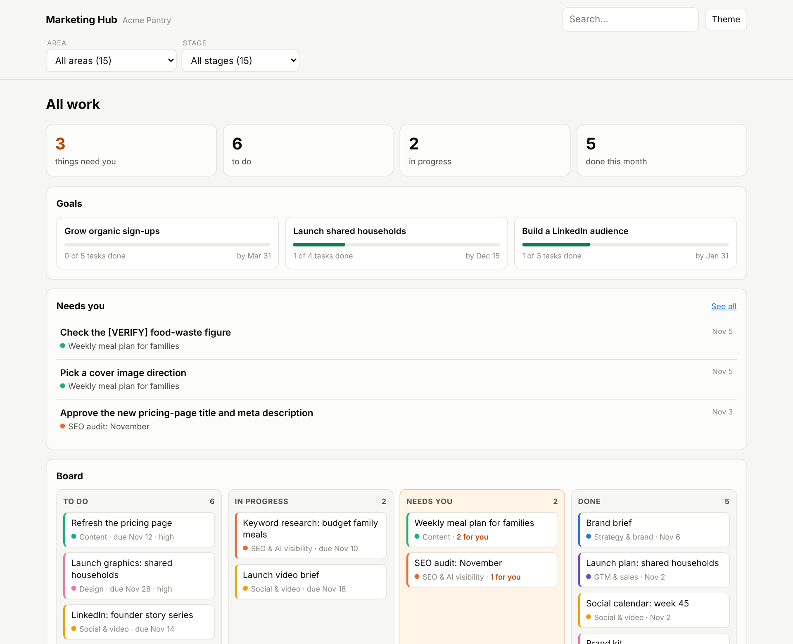
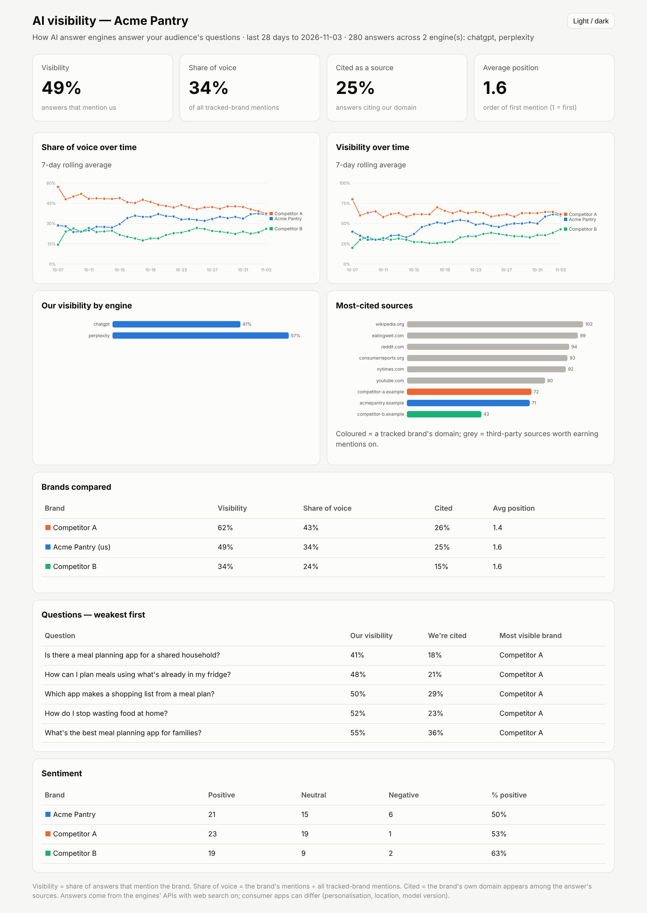

# AI Marketing Team for Claude

A seven-agent marketing team that plugs into Claude. Each agent owns one job: strategy, SEO and AI visibility, web content, social and video, design, paid ads, and go-to-market. They all read one **brand brief**, follow one set of **strategy rules**, and hand work to each other through **briefs**. You can set up the same team for any company by swapping the brief.



```
You: "We launch v2 on the 20th."

Team lead ─▶ GTM agent       tiers the launch, writes messaging, builds the timeline
                │             briefs every agent ▼
                ├─▶ Web content   feature page + launch article (with internal links)
                ├─▶ Social & video  launch posts + video brief for Claude Motion
                ├─▶ Design        launch graphics and ad creatives in every size
                ├─▶ Ads           LinkedIn + Meta campaign plan and copy
                └─▶ Strategist    reviews everything against brand and strategy
```

## The team

| Agent | Owns | Skills |
|-------|------|--------|
| **Strategist** | Marketing and channel strategy, campaigns and promos, the rules every agent follows, final review | `strategy` · `campaign-plan` · `brand-review` |
| **SEO & AI visibility** | What to create or fix, based on search data and how AI engines answer customer questions | `seo-audit` · `keyword-research` · `content-gap` · `ai-visibility` · `internal-linking` |
| **Web content** | Blog articles, new pages, page refreshes, always with internal linking | `blog-create` · `page-create` · `page-refresh` |
| **Social & video** | LinkedIn, X and Facebook posts, repurposing, the social calendar, video briefs | `social-post` · `social-repurpose` · `social-calendar` · `video-brief` |
| **Design** | Brand kit and every graphic: social, blog, pages, ads, launches, promos | `brand-kit` · `graphic` |
| **Ads** | Google, LinkedIn and Meta campaign plans, ad copy and creative, optimisation | `ad-campaign` · `ad-creative` · `ad-optimization` |
| **GTM & sales** | Product and market analysis, launches, sales enablement | `gtm-analysis` · `launch-plan` · `sales-enablement` |

Team skills: **`team-lead`** routes requests and runs the routines · **`workspace-setup`** turns an empty repo into a ready workspace · **`brand-setup`** writes the brand brief · **`hq`** shows the Marketing Hub.

## Highlights

### AI visibility (AEO / GEO)
A tracker asks ChatGPT, Perplexity, Gemini and Claude the questions your customers ask, every day, through their APIs. It records whether your brand and your competitors are mentioned, in what order, and which sources are cited. The SEO agent reviews the answers each week: it scores sentiment, works out why competitors win particular questions, and writes briefs to fix that. The fixes can be pages that answer those questions in a form AI engines can quote, earned mentions on the sources the engines cite, or corrections where AI answers are wrong.



### Senior-advisor depth
Strategic work follows shared research and analysis standards: the client's whole site and competitors' own current pricing pages (dated), a sweep for new entrants, real decisions answered with recommendation → reasoning → trade-offs → test, the math done with the client's numbers, and a "generic-advice test" that cuts anything that could apply to any company.

### Internal linking built into every page
Every article, new page and refresh suggests the links it should contain, and lists which existing pages should link to it, with the exact sentence to change. The suggestions come from a site index plus search results.

### Claude Design, Design System and Motion
When your Claude account offers them, the designer makes graphics as editable **Claude Design** canvases (you tweak and export them yourself), keeps the brand kit as a **Claude Design System** that every design uses, and the social & video agent can make videos in **Claude Motion** from its video brief. Without them, the team falls back to rendered PNGs and a paste-ready Motion brief. Links to everything that lives in Claude are kept in the workspace's `marketing/artifacts.md` and shown on the HQ.

### Visual output
Reports come with self-contained dashboards (light and dark mode, colour-blind-safe palette, tooltips, a table view). The **Marketing Hub** is the one page you open: a simple project board you filter by **area** (strategy, content, SEO & AI visibility, social & video, design, ads, GTM & sales) and **stage** (to do → in progress → needs you → done), with progress towards your goals, what needs you, and a built-in reader for every piece of work. The designer renders graphics to PNG at exact platform sizes.

## How it works

1. **Brand brief:** `marketing/brand-brief.md` holds product facts, audiences, positioning, voice, keywords, platforms, CTAs, the AI visibility questions and red lines.
2. **Strategy rules:** `marketing/strategy/*.md` are short, checkable rules written by the strategist. Every agent reads the ones for its channel.
3. **Routing by description:** Claude matches each request to an agent and skill. Ask in plain words, or call a skill directly, e.g. `/marketing-team:seo-audit`.
4. **Briefs as handoffs:** agents write briefs to `marketing/briefs/`, addressed to the agent that should act on them. The team lead passes them on in priority order.
5. **Team memory:** every deliverable carries a short header (status, summary, what needs you); the Hub indexes them in `marketing/index.md`.
6. **Routines:** weekly AI visibility, SEO, social and ads reviews, plus monthly gap and refresh runs, run as scheduled tasks. See [docs/scheduling.md](docs/scheduling.md).

Details: [docs/architecture.md](docs/architecture.md).

## Install

**Claude app:** Customize → Plugins → **+** → Add marketplace → `viktar-m/marketing-team`, then install **marketing-team**. Skills work in chat. The agents run in Cowork, so use the full team in a Cowork project with a folder or workspace connected.

**Claude Code:**
```
/plugin marketplace add viktar-m/marketing-team
/plugin install marketing-team@ai-marketing-team
```

## Get started

**One workspace per product or client:** a private GitHub repo, e.g. `mkt-<product>`.

1. Create an **empty private repo** on GitHub.
2. In Claude Code (the Code tab of the desktop app, or the terminal), start a session in that repo. In the Code tab: New → Cloud → choose the repo.
3. Type **"Set up a marketing workspace for <product>. Website: <url>."** The team creates the workspace (folders, session instructions, dashboard), drafts the brand brief from the website, and asks you a few questions.
4. Next: "Write our marketing strategy", then "Set up our brand kit" (add your logo and screenshots to `marketing/design/assets/` first), then "Set up AI visibility tracking" (see [docs/ai-visibility.md](docs/ai-visibility.md)).
5. **Start a new session for each task**, in the same repo: "Show me the Hub", "Work on the homepage refresh brief", "Plan next week's posts". The repo is the team's memory, so every session starts with full context.
6. When you're ready, schedule the routines ([docs/scheduling.md](docs/scheduling.md)).

To try the team without a real product, set up a workspace for the fictional sample in [`templates/sample-brand-brief.md`](plugins/marketing-team/templates/sample-brand-brief.md).

## Workspace

The team works in a `marketing/` folder — a local folder or a **private git repository** (scheduled runs and the daily AI visibility workflow can update it without your computer). This public repo git-ignores `marketing/`: the framework is public, your brand data stays private.

```
marketing/
├── hub.html          ← the Marketing Hub: open this
├── goals.md          ← your goals; the Hub shows progress
├── brand-brief.md    strategy/
├── web/  social/  video/  design/  ads/  sales/
├── launches/  campaigns/  research/
└── queue/            briefs waiting for an agent
```

**How the team keeps it usable:** every task produces one deliverable file (a short header — status, summary, what needs you — then the usable content first), the reply is a short "done" message with one link, and briefs exist only for follow-up work you agreed to. The **Marketing Hub** shows every task once, as a card that moves from to do to done; you move it by telling Claude ("approve the homepage refresh").

## Design principles

- **Deciding is separate from making.** The strategist, SEO and GTM agents decide what to do. The web, social, design and ads agents produce it.
- **No invented facts.** Unverified claims are marked `[VERIFY]` and listed for a human to check.
- **Humans approve spend and publishing.** The ads agent recommends changes and never changes live campaigns. Nothing is published automatically.
- **Brand-agnostic.** Nothing about a specific company is built into the agents or skills.

## Customise

- New platform: add a guide in `skills/social-post/platforms/` and size rows in the `graphic` skill.
- New agent (e.g., email): add `agents/<name>.md` and its skills, a row in `team-lead`, and the agent's name in `templates/brief.md`.
- Team-wide rules: `templates/conventions.md`. Visual style: `templates/dashboards.md`.

## Roadmap
- [ ] Email agent: newsletters, nurture and onboarding sequences
- [ ] Analytics agent: cross-channel performance reports
- [ ] Instagram and YouTube platform guides
- [ ] Approve and comment on work directly in the Hub

## License
MIT. See [LICENSE](LICENSE).
