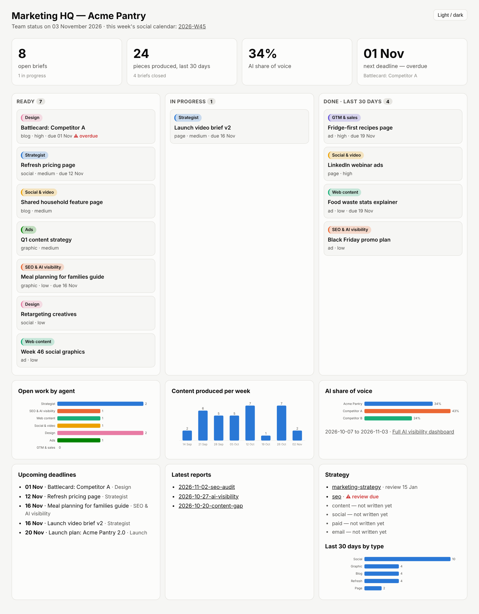

# AI Marketing Team for Claude

A seven-agent marketing team that plugs into Claude. Each agent owns one job: strategy, SEO and AI visibility, web content, social and video, design, paid ads, and go-to-market. They all read one **brand brief**, follow one set of **strategy rules**, and hand work to each other through **briefs**. You can set up the same team for any company by swapping the brief.



```
You: "We launch v2 on the 20th."

Team lead ─▶ GTM agent       tiers the launch, writes messaging, builds the timeline
                │             briefs every agent ▼
                ├─▶ Web content   feature page + launch article (with internal links)
                ├─▶ Social & video  launch posts + video brief for Claude Motion
                ├─▶ Design        launch graphics and ad creatives in every size
                ├─▶ Ads           LinkedIn + Meta campaign plan and copy
                └─▶ Strategist    reviews everything against brand and strategy
```

## The team

| Agent | Owns | Skills |
|-------|------|--------|
| **Strategist** | Marketing and channel strategy, campaigns and promos, the rules every agent follows, final review | `strategy` · `campaign-plan` · `brand-review` |
| **SEO & AI visibility** | What to create or fix, based on search data and how AI engines answer customer questions | `seo-audit` · `keyword-research` · `content-gap` · `ai-visibility` · `internal-linking` |
| **Web content** | Blog articles, new pages, page refreshes, always with internal linking | `blog-create` · `page-create` · `page-refresh` |
| **Social & video** | LinkedIn, X and Facebook posts, repurposing, the social calendar, video briefs | `social-post` · `social-repurpose` · `social-calendar` · `video-brief` |
| **Design** | Brand kit and every graphic: social, blog, pages, ads, launches, promos | `brand-kit` · `graphic` |
| **Ads** | Google, LinkedIn and Meta campaign plans, ad copy and creative, optimisation | `ad-campaign` · `ad-creative` · `ad-optimization` |
| **GTM & sales** | Product launches and sales enablement | `launch-plan` · `sales-enablement` |

Team skills: **`team-lead`** routes requests and runs the routines · **`brand-setup`** writes the brand brief · **`hq`** shows the Marketing HQ dashboard.

## Highlights

### AI visibility (AEO / GEO)
A tracker asks ChatGPT, Perplexity, Gemini and Claude the questions your customers ask, every day, through their APIs. It records whether your brand and your competitors are mentioned, in what order, and which sources are cited. The SEO agent reviews the answers each week: it scores sentiment, works out why competitors win particular questions, and writes briefs to fix that. The fixes can be pages that answer those questions in a form AI engines can quote, earned mentions on the sources the engines cite, or corrections where AI answers are wrong.


### Internal linking built into every page
Every article, new page and refresh suggests the links it should contain, and lists which existing pages should link to it, with the exact sentence to change. The suggestions come from a site index plus search results.

### Visual output
Reports come with self-contained dashboards (light and dark mode, colour-blind-safe palette, tooltips, a table view). The Marketing HQ shows the team's work as a board: open briefs by status and agent, deadlines, output per week, AI share of voice and strategy review dates. The designer renders graphics to PNG at exact platform sizes.

## How it works

1. **Brand brief:** `marketing/brand-brief.md` holds product facts, audiences, positioning, voice, keywords, platforms, CTAs, the AI visibility questions and red lines.
2. **Strategy rules:** `marketing/strategy/*.md` are short, checkable rules written by the strategist. Every agent reads the ones for its channel.
3. **Routing by description:** Claude matches each request to an agent and skill. Ask in plain words, or call a skill directly, e.g. `/marketing-team:seo-audit`.
4. **Briefs as handoffs:** agents write briefs to `marketing/briefs/`, addressed to the agent that should act on them. The team lead passes them on in priority order.
5. **Team memory:** `marketing/content-inventory.md` logs everything the team produces.
6. **Routines:** weekly AI visibility, SEO, social and ads reviews, plus monthly gap and refresh runs, run as scheduled tasks. See [docs/scheduling.md](docs/scheduling.md).

Details: [docs/architecture.md](docs/architecture.md).

## Install

**Claude app:** Customize → Plugins → **+** → Add marketplace → `viktar-m/marketing-team`, then install **marketing-team**. Skills work in chat. The agents run in Cowork, so use the full team in a Cowork project with a folder or workspace connected.

**Claude Code:**
```
/plugin marketplace add viktar-m/marketing-team
/plugin install marketing-team@ai-marketing-team
```

## Get started

1. **Brand brief:** "Set up the marketing team for <your website>." To try the team first, copy [`templates/sample-brand-brief.md`](plugins/marketing-team/templates/sample-brand-brief.md), which describes a fictional company, to `marketing/brand-brief.md`.
2. **Strategy and brand kit:** "Write our marketing strategy." Then "Set up our brand kit."
3. **Connect your data:** Search Console, Analytics and your ad platforms. Without them, agents label their numbers as estimates.
4. **AI visibility:** "Set up AI visibility tracking." See [docs/ai-visibility.md](docs/ai-visibility.md) for the API keys.
5. **Give the team work:** "Plan the v2 launch", "Audit our blog", "Next week's posts", "Why is our CPA up?", "Show me the HQ".
6. **Schedule the routines:** [docs/scheduling.md](docs/scheduling.md).

## Workspace

The team works in a `marketing/` folder. That can be a local folder or a **private git repository**, which scheduled runs and the daily AI visibility workflow can update without your computer. This public repo git-ignores `marketing/`: the framework is public, and your brand data stays private.

```
marketing/
├── brand-brief.md        strategy/          briefs/
├── content-inventory.md  campaigns/         launches/
├── content/              design/            ads/
├── sales/                ai-visibility/     site/
├── reports/              calendar/          dashboards/  (hq.html)
```

## Design principles

- **Deciding is separate from making.** The strategist, SEO and GTM agents decide what to do. The web, social, design and ads agents produce it.
- **No invented facts.** Unverified claims are marked `[VERIFY]` and listed for a human to check.
- **Humans approve spend and publishing.** The ads agent recommends changes and never changes live campaigns. Nothing is published automatically.
- **Brand-agnostic.** Nothing about a specific company is built into the agents or skills.

## Customise

- New platform: add a guide in `skills/social-post/platforms/` and size rows in the `graphic` skill.
- New agent (e.g., email): add `agents/<name>.md` and its skills, a row in `team-lead`, and the agent's name in `templates/brief.md`.
- Team-wide rules: `templates/conventions.md`. Visual style: `templates/dashboards.md`.

## Roadmap
- [ ] Email agent: newsletters, nurture and onboarding sequences
- [ ] Analytics agent: cross-channel performance reports
- [ ] Instagram and YouTube platform guides
- [ ] Interactive HQ with filters and drill-down

## License
MIT. See [LICENSE](LICENSE).
