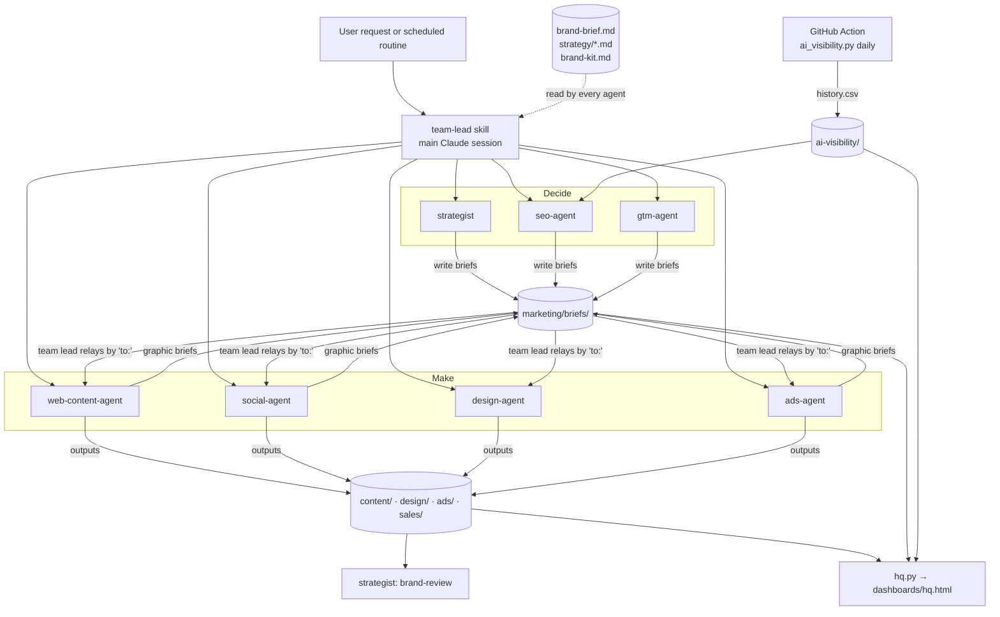

# Architecture

## Components

## Deciding is separate from making

Three agents **decide**: the strategist (strategy, campaigns, review), SEO & AI visibility (what the site needs) and GTM (launches, sales). Four agents **make**: web content, social & video, design, ads. The deciding agents never write final copy or graphics. The making agents never set strategy on their own. This keeps each agent's instructions short, and you can always trace why a piece of work exists back to the report or plan behind it.

The **designer is its own agent**, not a skill inside each maker. Every graphic goes through one place, which keeps the visual identity consistent across social posts, blog posts, ads and launches.

## Routing

Claude routes by **description**: each agent and skill description says what it does and when to use it, with example requests. Descriptions don't overlap, so routing is predictable. The `team-lead` skill adds explicit rules for ambiguous requests, and defines how routines run.

## Handoffs

Subagents can't call each other. Agents write **briefs**, Markdown files with a `to:`, `type:`, `priority:`, `due:` and `status:` header. The main session (the team lead) passes each brief to the agent named in `to:`, handling dependencies along the way: copy before design, design before ads go live, approved messaging before launch work. Briefs are files, so a scheduled run can pick up where the previous one stopped, and the HQ can show the queue.

## Strategy as rules

Strategy files end in a `## Rules` section of short imperative statements. Agents read the rules for their channel before working. The strategist's `brand-review` checks deliverables against those rules and quotes any rule that a piece breaks.

## AI visibility pipeline

1. `config.json` lists the brand, its aliases, competitors and 20–40 questions customers actually ask.
2. A **GitHub Actions workflow** in the private workspace repository runs `ai_visibility.py run` every day. API keys are stored as repository secrets, so they never enter a chat, a file or a Claude session. The script asks each engine (OpenAI Responses API with web search, Perplexity, Gemini with Google Search grounding, Claude with web search) and appends to `history.csv` and `citations.csv` whether each brand was mentioned, its position, and whether its domain was cited.
3. `ai_visibility.py report` builds the dashboard: visibility, share of voice, citation rate, average position, 7-day trends, results per engine, most-cited sources, and the weakest questions.
4. Each week the SEO agent reads the raw answers, scores sentiment, finds why competitors win, and writes briefs.

Mention detection matches whole words and is case-insensitive, across a brand's name and aliases. A citation counts when the cited domain is the brand's domain or one of its subdomains. Share of voice is a brand's mentions divided by all tracked-brand mentions.

## Dashboards

Dashboards are self-contained HTML files with inline SVG and no external dependencies, so they open offline and can be published as artifacts. They support light and dark mode and use a colour-blind-validated categorical palette, with the brand always in slot 1. `templates/dashboards.md` has the rules. `scripts/hq.py` and `scripts/ai_visibility.py` are the reference implementations.

## Skills load on demand

Agents list their skills in a table and load the one a task needs with the Skill tool, so only the instructions for that task enter the agent's context.
