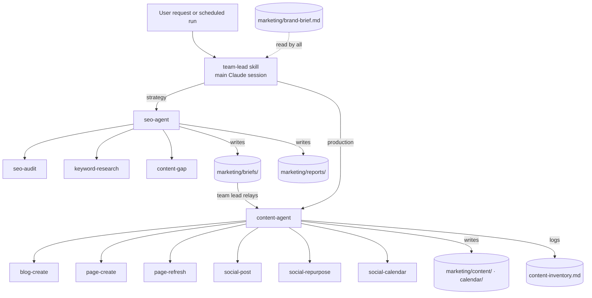

# Architecture

## Components

## Why two agents

Separating **deciding** from **making** mirrors how real marketing teams work and keeps each agent's instructions short and focused:

- The **SEO agent** gathers evidence (connected SEO tools, public pages, competitors) and outputs reports and prioritised content briefs. It never writes final copy.
- The **content agent** turns briefs or direct requests into publish-ready content. It doesn't decide strategy on its own.

Each agent runs as a Claude subagent with its own context window, so a long audit doesn't crowd out the writing, and the other way round.

## Routing

There's no hard-coded router. Claude matches each request to the agent and skill whose **description** fits best. That makes descriptions the most important text in the repo:

- Each description says what the component does *and* when to use it, with example requests.
- No two descriptions overlap, so routing is predictable.
- The `team-lead` skill adds explicit rules for ambiguous requests ("get more traffic" → SEO first, then content).

## Handoffs

Subagents can't call other subagents. The main session acts as team lead and relays work:

1. SEO agent returns a report path and a list of content brief paths.
2. Team lead hands each brief to the content agent, highest priority first.
3. Content agent sets the brief's `status: done` and records the output path.

Because briefs are files with a status field, a scheduled run can pick up where the last one stopped.

## Skills load on demand

Agents list their skills in a table and load the one a task needs with the Skill tool, instead of preloading all of them. Only the needed instructions enter the agent's context.

## Shared standards

`templates/conventions.md` holds the rules every component follows: where the brief lives, the workspace layout, the inventory, the handoff format, fact-checking rules and output defaults. Change a standard once there, and every agent follows it.
